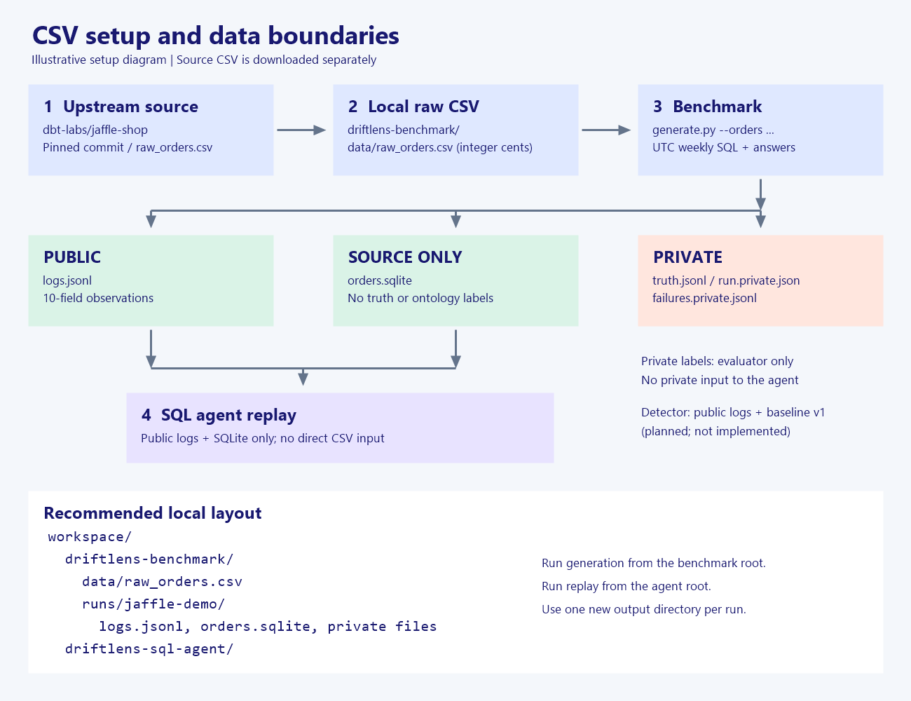

# DriftLens Benchmark

[English](README.md) | [한국어](README.ko.md)

Generate reproducible, SQL-grounded logs for research on changes in business definitions. Scenario A changes the definition of `large_orders` from orders worth at least 2,000 integer cents to at least 3,000 cents.

## Features

- Load CSV or JSONL orders and calculate weekly counts with SQLite.
- Produce Korean answers using a deterministic template or an Upstage model.
- Keep public observations separate from private labels, failures, and run metadata.
- Validate answer numbers against the executed SQL result and reject common definition-leakage terms.
- Provide a strict public-log loader and a bounded, read-only SQLite tool for the companion agent.

## Requirements and quick start

Python 3.11 or later. Local template execution uses the Python standard library. Run these commands from the repository root in PowerShell:

```powershell
python -m unittest -v
python generate.py --orders data/fixture_orders.csv --start 2025-01-06 --weeks 2 --out runs/demo
```

The eight-row synthetic fixture produces counts of **3 and 2** with the default change date, 2025-01-15. It is not the full jaffle-shop dataset. Template answers are not LLM-generated data.

Choose a new output directory for each run; an existing directory is rejected. The requested full weeks must fit within the source date span.

For model-generated answers, configure `UPSTAGE_API_KEY` and `UPSTAGE_MODEL` externally and add `--mode llm` to the generation command. `--model` overrides the model environment variable. Use a model supported by your account. Live provider compatibility and answer quality remain unverified; mocked HTTP tests do not establish them. Keep credentials and generated private data out of version control.

## Use the external CSV

The bundled fixture is enough for a first run. To use the external synthetic data, follow these steps from the **benchmark repository root** in PowerShell.



*Setup diagram, not an execution screenshot. The agent consumes the generated public log and SQLite snapshot; it does not load CSV directly.*

### 1. Identify the source and version

The source is [dbt-labs/jaffle-shop](https://github.com/dbt-labs/jaffle-shop/blob/5beb145b00f5465ec759cfcdd9745e858818cf95/README.md), a fictional-shop dbt sandbox. This guide pins commit [`5beb145b00f5465ec759cfcdd9745e858818cf95`](https://github.com/dbt-labs/jaffle-shop/commit/5beb145b00f5465ec759cfcdd9745e858818cf95) and its [`seeds/jaffle-data/raw_orders.csv`](https://github.com/dbt-labs/jaffle-shop/blob/5beb145b00f5465ec759cfcdd9745e858818cf95/seeds/jaffle-data/raw_orders.csv). Avoid a moving `main` URL when reproducing an experiment.

Only that CSV is needed. Do not clone or run the upstream dbt project for this path; no dbt Cloud, warehouse, or upstream dependency installation is required. Download the raw CSV, not the GitHub HTML page.

**Source and license:** the pinned repository tree contains no license file, and GitHub reports no detected repository license. A separate data license could not be confirmed. Public availability is not a verified redistribution grant; check permission with the upstream project for your intended reuse. This repository links to the source and does not redistribute its CSV. DriftLens's Apache-2.0 license does not establish a license for that external data.

### 2. Download into the expected location

Map upstream `seeds/jaffle-data/raw_orders.csv` to local `driftlens-benchmark/data/raw_orders.csv`. Keep the original header and values; no conversion is required for this pinned raw file. The local path is already ignored by Git.

```powershell
$sourceCommit = '5beb145b00f5465ec759cfcdd9745e858818cf95'
$sourceUrl = "https://raw.githubusercontent.com/dbt-labs/jaffle-shop/$sourceCommit/seeds/jaffle-data/raw_orders.csv"
if (Test-Path -LiteralPath 'data/raw_orders.csv') { throw 'data/raw_orders.csv already exists; verify or choose another filename.' }
Invoke-WebRequest -Uri $sourceUrl -OutFile 'data/raw_orders.csv'
Get-Content -LiteralPath 'data/raw_orders.csv' -TotalCount 1
Get-FileHash -LiteralPath 'data/raw_orders.csv' -Algorithm SHA256
```

The expected header is:

```text
id,customer,ordered_at,store_id,subtotal,tax_paid,order_total
```

Expected SHA256: `E8EE89233D417FD695D016588649C008D930110D50027480BB95B443EC0DC76B`. A mismatch means the bytes differ: verify the URL and file before using it. Keep the source commit and hash with your experiment notes; the generator also records its input SHA256 in private run metadata.

The pinned file has 61,948 rows dated 2024-09-01 through 2025-08-31. Its header, date span, and hash were checked; full benchmark execution on this file remains unverified.

### 3. Check the columns and run

| Raw CSV column | Required local meaning |
| --- | --- |
| `id` | Unique order identifier; loaded as SQLite `order_id` |
| `ordered_at` | ISO timestamp; normalized to a UTC date |
| `order_total` | Integer cents; loaded as `order_total_cents` |
| Other columns | Accepted but not used by this loader |

The raw timestamps have no offset, so DriftLens treats them as UTC. The upstream [staging SQL](https://github.com/dbt-labs/jaffle-shop/blob/5beb145b00f5465ec759cfcdd9745e858818cf95/models/staging/stg_orders.sql) also produces dollar-valued columns; **do not substitute its dollar `order_total` for the raw cents field**. The current loader has no configurable CSV renaming or currency conversion.

```powershell
python generate.py --orders data/raw_orders.csv --start 2025-01-06 --weeks 2 --effective-at 2025-01-15 --out runs/jaffle-demo
```

This uses template mode, a Monday start, and two complete weeks inside the checked date span. Choose an unused output directory. On success, expect two public log records, two matching private truth records, an empty failure file, run metadata, and `orders.sqlite` under `runs/jaffle-demo/`. External-data counts differ from the fixture's 3 and 2; no external-data count is claimed here.

### 4. Troubleshoot setup

| Symptom | Check |
| --- | --- |
| CSV not found | Run from the benchmark root; confirm `data/raw_orders.csv` exists, or pass its actual path to `--orders`. |
| Missing columns / CSV parsing error | Download the raw file, not HTML; keep `id, ordered_at, order_total`. Other datasets need preparation outside this loader. |
| Non-integer amount or unexpected counts | Use raw integer cents, not staging dollars; v1/v2 thresholds are 2,000/3,000 cents. |
| Date-range or Monday error | Use a Monday and complete weeks within the source span. The example above fits the pinned file. |
| Output directory already exists | Pick a new `--out` directory; do not delete results merely to rerun. |
| Agent cannot import benchmark modules | Use sibling checkouts and the agent README's `PYTHONPATH` or local package installation instructions. |
| Agent cannot open its inputs | Generate first, then point both `--logs` and `--db` to the same run directory. |

## Inputs and outputs

Input orders require `id`, `ordered_at`, and `order_total`. Amounts are **integer cents**, not dollars. Timestamps with time zones normalize to UTC; naive timestamps are treated as UTC.

| Output | Contents and access |
| --- | --- |
| `logs.jsonl` | Public L3 observations |
| `truth.jsonl` | Private labels joined by `log_id` |
| `run.private.json` | Private input hash, thresholds, change date, mode/model, time rules, and success/failure counts |
| `failures.private.jsonl` | Private generation failures; failed answers are not silently corrected |
| `orders.sqlite` | Source-only order snapshot without truth or ontology labels |

Generation failures cause exit code 1. The public log has exactly ten top-level fields:

```text
log_id, timestamp, agent_id, team, request, sql, answer_text,
definition_note, reported_values, referenced_concepts
```

`reported_values` contains concept/value/ISO-week observations from the actual SQL result. It is not an independent oracle for the latest business definition. A stale-definition query remains a valid observation.

Weeks run from Monday 00:00 UTC inclusive to the next Monday exclusive. The conversation timestamp is Sunday 23:59:59 UTC, and its active definition applies to the whole week. Changes start at UTC midnight; a 2025-01-15 change applies v2 to 2025-W03.

Private truth contains `log_id`, `ontology_version_used`, `drift_id`, and `contaminated`. Before the change these labels are v1/null/false; afterward they are v2/A/true. `contaminated` means a definition change relative to v1, not a SQL error or hallucination.

See the [contract](contracts/v1/README.md) for field rules and planned detection interfaces. Detectors must receive only permitted public logs and baseline v1, never private labels, future definitions, actual profiles, or change times. File separation and the public loader do not replace process-level access controls. L3 deliberately exposes SQL and definition clues.

## Repository structure

| Path | Role |
| --- | --- |
| `generate.py`, `driftlens.py` | Generation CLI and implementation |
| `public_logs.py`, `sql_tool.py` | Public input validation and read-only SQLite |
| `data/`, `test_*.py` | Synthetic fixture and offline tests |
| `contracts/`, `docs/` | Contracts and architecture |
| `datasets/`, `scenarios/`, `configs/` | Dataset/scenario documentation and planned configuration examples |
| `src/` | Comment-only placeholders for orchestration, adapter, logging, detection, and evaluation |

Read the [architecture guide (Korean)](docs/README.md) for module responsibilities, independent version tracking, and information boundaries.

## Companion agent and current status

[DriftLens SQL Agent](https://github.com/DriftLens-Team/driftlens-sql-agent) replays SQL from these public logs against the snapshot and checks answer consistency. It currently imports this repository's loader, SQL tool, and validator. It does not independently generate SQL from a question.

A separate-process JSONL connection, external profile-driven engine, L0–L2 projections, fixed-definition control execution, drift detection, and scoring are planned, not implemented. Configuration examples are not read by the current CLI.

Offline tests cover boundaries, reproducibility, mocked model responses, public/private separation, and SQL restrictions. Full jaffle-shop execution and live model behavior remain unverified. Numeric extraction ability is not evaluated, and automated answer checks do not rule out all semantic leakage.

## License

[Apache License 2.0](LICENSE)
