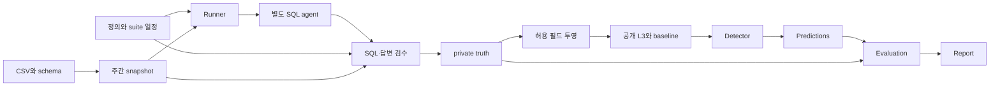

# Architecture

현재 package는 C03 한 개념·주간 integer count·SQLite·L3를 지원한다. 데이터와 case/suite는 선언적 파일이며 settings에서 unknown/duplicate keys와 경로·version·checksum을 검증한다.

runner는 기준/변경 정의를 고르는 관리자다. 에이전트에는 현재 profile만 주고, 탐지기에는 baseline과 공개 관측만 준다. 업무 정의 v1/v2와 통신 agent/v1, 관측 records/v2, 탐지 detection/v1은 별개다.

같은 주의 변경/고정군은 동일 snapshot을 사용한다. 다음 주 주문은 보이지 않고 이전 이력은 남는다. 요청마다 프로세스를 시작해 설정과 모델 상태를 격리한다. 표준 출력은 JSONL, 진단 원문은 저장하지 않는다.

truth는 실제 관측과 평가 정보를 함께 보관한다. 검증을 통과한 관측만 공개로 복사한다. 답변 숫자가 SQL과 맞아도 정의가 바뀌었을 수 있다. SQL이 적용 정의를 따르지 않았다면 생성 오류로 분리하며 주입한 정의 변경 탐지 점수에 섞지 않는다.

현재 OS sandbox/container는 없다. 프로세스와 폴더 경계는 API 설계이며 파일 접근 보안 경계를 보장하지 않는다. 모든 실행과 보고서에 unisolated를 표시한다. 공개 케이스를 사전에 알고 있을 가능성까지 제거한 held-out benchmark는 아직 아니다.
