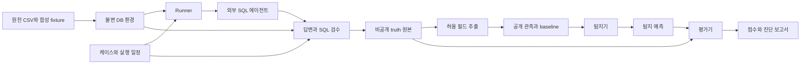

# 아키텍처와 연결 설계

상태: 승인 당시 제안 원문을 보존한 기록. 현재 구현 범위는 [현재 아키텍처](../../architecture.md)를 따른다. 아래 미구현 표시는 제안 당시의 상태다.

## 실행 흐름



에이전트는 질문·선택된 현재 정의·허용 DB를 받고 SQL과 답변을 만든다. 탐지기는 기준 정의와 허용 관측을 보고 의미 변화를 추정한다. 평가기는 정답을 알고 탐지 결과를 채점한다. 같은 모델을 쓰더라도 세 역할의 입력과 실행 환경을 분리한다.

`runner.py`는 단계 순서를 조립한다. 적재 SQL, 프로토콜 처리, 판정 알고리즘, 점수 산식을 직접 구현하지 않는다. 핵심 모듈 사이에는 contract 타입으로 데이터를 전달한다.

## DB와 케이스의 관계

`datasets/jaffle_shop/schema.sql`은 정규화된 `customers`, `orders`, `items`, `products`, `supplies`, `stores`를 정의한다. 날짜는 UTC, 금액은 integer cents로 정규화한다. 원천의 복합 키와 단위를 유지한다.

| 계층 | 보관물 | 예 |
| --- | --- | --- |
| 원천 | 원본 CSV·출처·commit·checksum | Jaffle Shop 원천 6종 |
| 공통 DB | 정규화 테이블, 데이터 제약 | 동일 주문·품목을 모든 케이스가 사용 |
| 케이스 | v1/v2·참조 SQL·경계 기대값 | C03 총액 2000 → 3000 cents |
| suite | 케이스 선택·일정·대조군·split | 각 개념의 변경군과 정의 고정군 |
| 실행 snapshot | source hash·schema version·as-of | 요청 시점까지 관측 가능한 사실 |

DB schema에는 `semantic_drift`, `effective_at`, `definition_version_used` 같은 정답 컬럼을 만들지 않는다. 정의를 바꾸기 위해 원천 주문액을 조작하지 않는다. 합성 고객 이력 등 데이터 보강은 별도 provenance와 seed를 갖는다.

현재 SQL agent는 `orders(order_id TEXT, ordered_at TEXT, order_total_cents INTEGER)`의 **이름·타입·순서·컬럼 개수와 실제 테이블 여부까지** 검사한다. 따라서 확장 DB와 별도로, 같은 source snapshot에서 이 세 컬럼만 담은 `agent-v1.sqlite`를 만든다. view로 대체하거나 컬럼을 추가해서 전달하지 않는다. 두 DB의 연결은 private manifest의 source hash·변환 버전으로 추적한다.

시간순 실험은 전체 미래 데이터를 에이전트에 전달하지 않는다. `environments/`가 요청의 `as_of`까지 제한한 불변 snapshot을 구성하고 캐시한다. 이력 기반 개념은 보고 기간 이전 이력도 보존하되 T 이후 주문은 제외한다. 탐지기는 기본적으로 DB 없이 공개 관측과 baseline만 받는다. 향후 DB 도구를 제공하는 트랙은 별도 계약이 필요하다.

## 세 가지 독립 계약

| 계약 | 초기 정책 | 이유 |
| --- | --- | --- |
| `agent/v1` | 현재 외부 agent의 네 필드 요청/성공·실패 응답 유지 | 이미 구현된 JSONL과 연결 |
| `records/v2` | 확장 공개 관측·private truth·run manifest | 문서의 result_id·window·as_of·concept_truth 수용 |
| `detection/v1` | 탐지 입력·예측·근거·유보 | 탐지기와 채점기를 교체 가능하게 함 |

JSON Schema와 타입은 `src/driftlens_benchmark/contracts/` 한 곳을 정본으로 둔다. JSON 파일을 패키지 리소스로 배포하며 설치 후에도 검증할 수 있게 한다. 문서는 schema와 예시를 링크하고 필드 정의를 중복 관리하지 않는다. 디렉터리는 `agent/v1/`, `records/v2/`, `detection/v1/`로 구분한다.

업무 정의의 v1/v2, agent 프로토콜 v1, 관측 포맷 v2는 서로 다른 버전이다. 파일 확장에 기존 v1 스키마를 조용히 재해석하지 않는다. 기존 공개 로그 10필드는 이름을 유지하되 하위 결과 구조 변경은 records v2로 선언한다. 버전은 bundle manifest/실행 인자에 명시하고 기존 agent 요청에 새 필드를 끼워 넣지 않는다.

## 외부 챗봇 연결

초기 어댑터 두 개를 제안한다.

1. `jsonl.py`: 별도 프로세스의 stdin/stdout으로 요청·응답을 교환한다. Python, Node 등 구현 언어와 무관하다.
2. `submissions.py`: 이미 생성한 질문·SQL·답변을 파일로 받아 관측 검수부터 시작한다. SQL만 받아 답변을 임의 생성하지 않는다.

현재 agent용 선택 설정은 `configs/agents/sql-agent-v1.yaml`에 둔다. command는 문자열 shell 조합 대신 인자 배열로 관리한다. 런타임 설정·profile은 케이스의 정의에서 변환해 `runs/<id>/private/agent/`에 생성한다. 외부 agent의 profile 예시를 benchmark의 업무 정의 정본으로 사용하지 않는다.

실행 명령의 실제 형태는 다음과 같다. 아래 경로는 문서용 자리표시자다.

```text
python -m driftlens_sql_agent --config <generated-config.json> --profile <selected-profile.json> --protocol-version v1
```

요청 예시는 현재 계약을 그대로 따른다.

```json
{"request_id":"req-001","request":"이번 주 대형 주문은 몇 건인가요?","timestamp":"2025-01-19T23:59:59Z","period":"2025-W03"}
```

adapter의 책임:

- UTF-8 bytes, 한 줄당 한 객체, ID 일치·중복·응답 누락 검사.
- stdout은 프로토콜, stderr는 private 진단으로 분리.
- 줄 크기 상한 65,536 bytes, 요청 timeout, 프로세스 종료를 처리.
- status와 종료 코드를 모두 확인. 종료 코드 0이어도 요청 실패일 수 있음.
- profile 변경 또는 DB snapshot 변경 시 프로세스를 재시작. agent가 시작할 때 읽은 설정을 중간에 바꾸지 않음.
- 기존 `period`를 records v2의 UTC `[window.start, window.end)`와 `as_of`로 변환. 해당 변환은 일요일 마지막 초 timestamp 규칙을 유지.
- 현재 agent에 C03 이외의 concept·조인·평균·비율을 보내지 않음. capability 사전 검사에서 명시적인 `unsupported`로 중단.
- benchmark/agent 내부 모듈을 상호 import하지 않음. 두 저장소를 형제 폴더에 두어야 한다는 전제를 제거.

다른 챗봇의 결과는 요청 등록부와 결합해 snapshot·period·as-of를 확인해야 한다. 정의와 snapshot을 검증할 수 없는 임의 과거 로그는 탐지 시연에는 사용할 수 있지만 정답이 확인된 벤치마크 점수로 집계하지 않는다. 다중 테이블을 지원하는 agent 계약은 별도 후속 버전으로 합의한다.

## 관측과 정답

설계 문서의 원칙대로 **private truth 원본을 먼저 만들고 public logs를 투영**한다. 동일 노출 수준의 `log_id`에 대해 공개한 필드의 값은 원본과 같아야 한다. `reported_values`는 실제 실행 SQL의 관측값이며 기준 정의의 기대값으로 덮어쓰지 않는다.

```text
runs/<opaque-run-id>/
├── environment/             # 생성/검수 전용 DB·정규화 메타데이터
├── public/
│   └── L3/
│       ├── manifest.json    # records 버전·노출 수준·공개 파일 hash만
│       ├── baseline.json    # 기준 정의와 허용 원천 정보
│       └── logs.jsonl       # nested allowlist로 추출한 관측
├── private/
│   ├── truth.jsonl          # 공개 관측 전체 + concept_truth + validation
│   ├── scenarios.private.json
│   ├── run.private.json    # commit·snapshot·일정·seed·설정·출처·split
│   ├── failures.jsonl
│   └── agent/              # 이번 요청에 선택한 현재 profile/config
├── predictions/
│   └── <detector-id>.jsonl
└── reports/
    ├── metrics.json
    └── report.md
```

공개 manifest에는 case 경로, 실제 profile, v2 hash, 변경일, split 정답을 넣지 않는다. agent ID·파일명·요청 ID에도 변경 여부를 인코딩하지 않는다. 로그의 concept_id는 공개된 기준 개념과 연결하되 benchmark의 case catalog 자체를 탐지기에 제공하지 않는다.

`private/`라는 이름은 접근 통제가 아니다. 공식 격리 실행에서는 탐지 프로세스에 `public/<level>/`와 허용 detector 설정만 마운트/전달하고, repo·DB·private·네트워크에는 접근시키지 않는다. 컨테이너 등 실제 격리가 없는 로컬 디버그 실행은 `unisolated`로 기록한다. 공개 저장소의 케이스를 모델이 사전에 알고 있을 가능성과 실행 중 정답 노출은 구분해서 보고한다.

초기 구현은 L3만 지원한다. 후속 노출 수준 제안은 L0=숫자·답변, L1=숫자·답변·정의 설명, L2=숫자·답변·SQL, L3=전체다. 기존 문구의 해석에 의존하지 않고 이 매핑을 새 contracts 문서에서 명시적으로 확정한다. 하위 수준은 질문·자유 답변·unit에 정의가 새는지도 검수한다. 누출을 지우려고 원문 답변을 임의 수정하지 않고 부적격 샘플을 표시/제외하며 수를 보고한다.

## 정답과 탐지에서 구분할 네 축

| 축 | 의미 | 다른 축과의 관계 |
| --- | --- | --- |
| `semantic_drift` | 의도된 적용 정의가 기준 정의와 달라졌는가 | 값이 우연히 같아도 true 가능 |
| `output_changed` | 같은 snapshot·기간에서 두 참조 결과가 다른가 | 자연 시계열 증가와 다름 |
| `query_correct_for_used_definition` | agent SQL이 적용 정의를 구현하는가 | 문법 성공/숫자 일치만으로 true 확정 불가 |
| `answer_matches_query_result` | 답변이 실제 쿼리 결과와 맞는가 | SQL의 업무 의미 정확성을 보장하지 않음 |

검증 미완료는 `null`, 성공은 `true`, 실패는 `false`로 보관한다. SQL 실행 성공과 결과 동등성은 별도 증거로 기록한다. 참조 SQL과 문자열이 다르다는 이유만으로 틀렸다고 하지 않는다. 단일 DB에서 결과가 같다는 이유만으로 의미적으로 동등하다고 확정하지 않는다. 지원하는 SQL 형태의 구조 검사와 경계 fixture를 사용하고, 지원 범위 밖은 유보한다.

초기 생성 실험의 drift 정답은 승인된 정의 일정에서 온다. SQL이 해당 정의를 따르지 않은 생성 오류는 정답 검수 실패로 분리한다. 실제 SQL의 잘못된 의미를 탐지하는 별도 과제와 의도적으로 주입한 정의 변경 탐지 과제를 한 점수에 섞지 않는다.

## 탐지와 채점

`detectors/`는 우선 항상 no_drift를 내는 기준선과, 지원된 SQL의 threshold/filter/집계 단위를 기준 정의와 비교하는 규칙 탐지기를 제공한다. 원문 SQL의 단순 문자열 비교를 정답 판정기로 사용하지 않는다. SQL 분석이 불가능하거나 공개 근거가 부족하면 `abstain`을 허용한다. 숫자 변화 탐지기는 후속 비교군이며 의미 변경을 증명하는 도구로 간주하지 않는다.

예측은 `(log_id, result_id, concept_id)`에 대해 `drift | no_drift | abstain`, `evidence_log_ids`, 근거 설명, 선택적 score·추정 변화 시점을 낸다. score의 범위와 방향은 detector별로 명시한다. 시간순 평가에서 미래 로그 ID를 근거로 쓰거나 미래 baseline을 읽으면 해당 제출을 무효 처리한다.

평가 보고서에는 다음을 함께 기록한다.

- 전체 요청 수, 성공 관측 수, 검수 적격 수, 실패·미검증·지원 불가 수.
- 적격 전체에서 TP/FP/TN/FN와 유보 수. 양성 유보는 recall의 미탐으로 포함하고 coverage를 별도 보고.
- 결정한 항목에 대한 precision, 전체 적격 양성에 대한 recall, F1, 정의 고정 대조군의 오탐률. 0분모는 이유 있는 null.
- 케이스별 점수와 macro/micro 집계, 결과형·관측 수준·실행 모드별 분리.
- 프로토콜/SQL/답변 실패율. 실패를 no_drift나 drift로 대체하지 않음.
- 반복 실행의 seed·모델·설정·횟수와 분산. fixture 성공을 live 모델 성능으로 표시하지 않음.

변화 시점 추정은 `effective_at`, `first_observable_at`, `first_alert_at`를 분리한다. 최초 관측 가능 시점의 규칙과 허용 오차가 확정되기 전에는 지연 점수를 공식 지표로 제공하지 않는다. 개발 기본 제안은 첫 변경 정의 적용 보고를 기준으로 1개 주간 구간의 허용 오차를 별도 실험 설정에 고정하는 것이다. 식별 불가능한 경우는 null과 사유를 기록한다.

suite는 split·시간 구간·seed·변경 일정을 평가 전에 고정한다. 같은 원천 기간의 인접 로그를 무작위로 섞어 독립 test라고 주장하지 않는다. 탐지기 임계값 조정은 개발 split에서 하고 test manifest는 사전에 고정한다.

## 제안 CLI

다음 명령은 **구현할 사용 경험**이며 현재 실행할 수 없다.

```text
driftlens-benchmark validate --suite benchmarks/suites/smoke.yaml
driftlens-benchmark run --config configs/runs/smoke.yaml --out runs/demo
driftlens-benchmark detect --public runs/demo/public/L3 --detector sql-rules --out runs/demo/predictions/sql-rules.jsonl
driftlens-benchmark evaluate --run runs/demo --predictions runs/demo/predictions/sql-rules.jsonl
```

`run`은 환경 생성 → agent 호출/파일 입력 → 관측 검수 → truth 저장 → public 추출까지 수행한다. `detect`는 정답을 받지 않고, `evaluate`만 private에 접근한다. 기존 output 디렉터리는 덮어쓰지 않는다. 단계 실패 시 실행 상태와 처리 건수를 남기고 미완료 실행을 완성된 점수로 표시하지 않는다.
