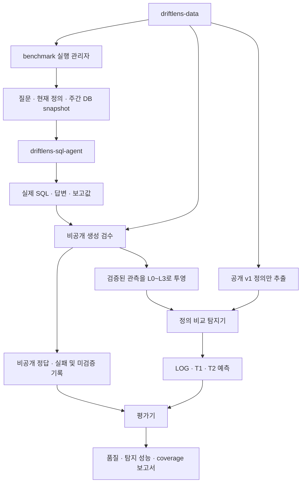

# SemAlign 채점기 설계안

작성일: 2026-10-27 · 구현 갱신: 2026-10-28 · 상태: **초기 생성·검수·탐지·채점 흐름 구현**

2026-10-28 구현 범위: data 의미 명세·입력 검사, 외부 agent/v2, 주간 snapshot, 비공개 검수와 새 truth, SQL/설명 비교, LOG/T1/온라인 T2 및 품질·기권·지연 보고. source fixture, 실제 companion의 fake provider 전체 실행과 실제 모델 7건을 구분해 확인했다. 명령과 제한은 [전체 실행 안내](semalign-runtime.md), 결과는 [검증 기록](semalign-verification.md)을 따른다. 아래 설계의 자유 자연어 모델·독립 평가 환경·미지 시나리오 등 연구 확장은 구현 완료 범위와 구분한다.

목표 흐름은 `driftlens-data → driftlens-sql-agent → driftlens-benchmark`다. 실제 SQL과 답변은 SQL agent가 생성하고, benchmark는 실행 조정·생성 검수·정의 변경 탐지·성능 채점을 담당한다.

최초 설계 때 읽은 코드는 benchmark `ee1782c`, sql-agent 로컬 `b67ec9c`와 원격 main `fbdb48d`, data `163da89`다. 당시 sql-agent 두 ref의 실행 코드와 계약은 동일했다. 아래는 설계 의도이며, 현재 지원 경로·명령·계약은 위 실행 안내와 기계 판독 schema를 따른다. 비공개 데이터의 변경 후 정의·변경일·정답 행은 이 문서에 복사하지 않는다.

## 1. 설계 결정

1. **주 탐지 방식은 정의 비교다.** SQL에서 집계 대상·조건·계산식을 추출하고 공개 기준 정의와 비교한다. 수치 차이를 semantic drift의 정의로 사용하지 않는다.
2. **DB는 생성기와 비공개 검수기에 제공한다.** 주 탐지기에는 공개 기준 정의와 선택한 노출 수준의 로그만 제공한다. DB 사용 진단은 별도 트랙이다.
3. **생성 품질과 탐지 품질을 분리한다.** 지정한 정의를 따르지 못한 SQL, 잘못된 숫자, 응답 실패를 drift 정답으로 바꾸지 않는다.
4. **모르는 경우는 abstain이다.** 일부 SQL 조건을 읽었다는 이유로 전체 의미가 맞다고 판정하지 않는다. 지원하지 않는 구문, 필수 조건 누락, 모호한 설명을 기록한다.
5. **기존 실행 기반을 재사용한다.** JSONL 프로세스 연결, 읽기 전용 실행, 공개 필드 제한, 무결성 검사, 실패 집계는 유지한다. 기존 케이스는 새 흐름 검증 후 전환한다.
6. **첫 범위는 7개 지표, 주간 스칼라 하나다.** 다중 결과, 공간적 정의 차이, 여러 번의 정의 변경, 임의 SQL의 완전한 동치 증명은 후속 범위다.

## 2. 저장소와 정보 경계

| 구성 | 책임 | 접근 가능한 정보 |
|---|---|---|
| driftlens-data | 원천 DB·스키마·기준 및 변경 정의·시나리오·참조 계산 관리 | 전체 데이터와 정답 |
| benchmark 실행 관리자 | 버전 고정, 주별 snapshot, 질문 준비, 현재 profile 선택, agent 실행 | 전체 시나리오; 모델에 필요한 현재 정보만 전달 |
| driftlens-sql-agent | 현재 정의에 맞는 SQL 생성·실행, 답변 생성 | 질문, 현재 profile 하나, 스키마, 해당 시점의 읽기 전용 DB |
| benchmark 생성 검수기 | SQL 의미·실행 결과·답변·보고값 확인, 평가 적격 여부 결정 | 적용 정의, 기준 정의, DB, 참조 SQL, 비공개 검증 fixture |
| benchmark 탐지기 | 공개 근거만으로 기준 정의와의 차이를 판단 | 공개 baseline, 선택한 L0~L3, 공개 쌍/시계열 인덱스 |
| benchmark 평가기 | 예측과 비공개 정답 결합, 분모·점수·오류 분석 | 제출 예측, 검수 정답, 실행 실패 기록 |

에이전트에는 미래 profile, profile 버전명, 변경 일정, drift 라벨을 주지 않는다. 탐지기에는 DB·참조 계산값·변경 후 정의·검수 결과·실행 설정을 주지 않는다. 생성에 필요한 스키마와 현재 정의는 에이전트에 제공한다.



이 그림은 논리적 경계다. 현재 로컬 프로세스는 파일 접근을 OS 수준에서 격리하지 않으므로 실행에 `unisolated`를 기록한다. 외부 탐지기나 LLM 도구에는 전체 workspace 접근을 연결하지 않는다. 독립 평가를 주장하는 실행은 공개 bundle만 읽도록 별도 격리 환경을 구성해야 한다.

## 3. 데이터에서 실제 에이전트 출력까지

### 3.1 두 실행 모드

| 모드 | 목적 | 입력 로그의 출처 |
|---|---|---|
| `fixture` | 계약·검수·탐지·채점 연결의 결정적 확인 | data 저장소의 커밋된 합성 로그 |
| `agent` | 실제 에이전트가 생성한 답변의 평가 | 선택된 모델로 새로 생성한 observation |

두 모드의 결과를 합산하지 않는다. fixture 성능을 실제 LLM 성능으로 보고하지 않는다. agent 모드에서 기존 `sql`, `answer_text`, `definition_note`, `reported_values.value`를 모델의 정답 예시나 입력으로 복사하지 않는다. 기존 로그는 질문·개념·기간의 요청 계획으로만 재사용한다.

### 3.2 요청 계획과 DB

1. data 커밋, DB/스키마/ontology/질문 파일 hash를 고정한다. 원천은 로컬 data checkout에서 읽고 benchmark에 복제 커밋하지 않는다.
2. 내부 표본 키는 `(dataset_id, concept_id, window.start, replicate_id)`로 둔다. 공개 `log_id`와 agent의 `request_id`는 별도로 발급하고 연결 표는 비공개로 둔다.
3. 현재 data의 `window.start >= effective_at` 규칙으로 적용 정의를 고른다. 질문이 들어온 날짜로 정의를 선택하지 않는다.
4. DB snapshot은 해당 주 종료 전의 주문과 연결 품목을 포함하고 이전 이력을 보존한다. 신규 고객의 최초 주문 및 전주 성장률 계산에 과거 이력이 필요하다. 같은 주의 지표는 같은 불변 snapshot을 사용할 수 있다.
5. 모델에 현재 정의 하나와 해당 개념의 스키마만 제공한다. 질문이나 모델 출력으로 profile을 바꾸지 않는다.
6. 현재 agent의 요청별 상태 격리를 유지한다. 최초 구현은 요청별 프로세스 실행을 유지하며, 프로세스 재사용 최적화는 별도 검증 후 한다.
7. 프로토콜·모델·SQL 실패는 실패 기록으로 남긴다. 성공 관측을 임의로 합성하거나 음성 판정으로 대체하지 않는다.

### 3.3 현재 agent에서 필요한 확장

현재 agent/v1은 `large_orders`, orders 일부 열과 COUNT, 음수가 아닌 정수 결과, ISO 주차 및 일요일 23:59:59 timestamp에 한정된다. 설정 파일만 바꿔서는 현재 7개 지표를 실행할 수 없다.

agent/v2에서 필요한 것은 다음과 같다.

- 현재 개념 하나의 업무 정의를 표현하는 profile. v1/v2 여부나 변경일은 포함하지 않는다.
- orders, order_items, products, locations를 개념별로 허용하고 필요한 JOIN·GROUP BY·집계·서브쿼리·CTE를 지원하는 읽기 전용 SQL 도구.
- 정수·유한 소수·정의상 계산 불가인 null을 지원하는 결과 검증. 음수 성장률도 유효하다.
- 모델 생성 SQL을 그대로 기록하고, 실행값과 일치하는 구조화 결과 및 답변을 반환하는 계약.
- 답변의 숫자·단위·계산 불가 표현 검증. 정의 설명과 숫자 답변을 별도 필드로 유지.
- protocol version과 지원 개념/스키마를 시작 전에 확인하는 호환성 검사. agent/v1에 새 형식을 조용히 보내지 않는다.

현재 agent의 `definition_note`는 모델의 자유 설명이 아니라 host가 선택한 profile에서 만드는 문장이다. 이 방식은 정확한 정의 설명을 제공하지만 L2를 쉽게 만들 수 있다. 초기 agent/v2도 이 출처를 명시하고, run manifest에 `definition_note_origin=profile_rendered`를 기록한다. 모델이 직접 쓴 설명을 평가하는 실험은 별도 `model_generated` 실행으로 분리하고 SQL과의 일치 여부를 검수한다. 데이터 정답을 보고 설명을 바꾸거나 일부 로그만 선택적으로 모호하게 만들지 않는다.

## 4. 비공개 생성 검수와 정답

검수는 탐지보다 먼저 수행하지만, 검수 결과나 적용 정의는 탐지기 입력에 포함하지 않는다.

| 검사 | 의미 |
|---|---|
| `query_correct_for_used_definition` | 실제 SQL이 지정된 업무 정의의 대상·조건·집계·기간을 구현했는가 |
| `query_result_matches_reference` | 같은 snapshot에서 SQL 실행값이 적용 정의의 참조 계산과 맞는가 |
| `reported_value_matches_query_result` | 구조화 보고값이 SQL 실행값과 맞는가 |
| `answer_matches_query_result` | 자연어 답변의 수치·단위·계산 불가 상태가 맞는가 |
| `definition_note_consistent` | 설명이 실제 SQL과 모순되지 않는가; 모호하지만 모순 없는 설명은 허용 |

상태는 `validated`, `rejected`, `unverified`로 나눈다. 확인된 불일치는 rejected, 증명할 수 없는 의미나 답변 형식은 unverified다. 전부 검증된 관측만 주 평가의 공개 입력으로 내보낸다. 정의 설명이 모호한 것과 SQL 의미를 검증할 수 없는 것은 다른 상태다.

**실행값 일치만으로 SQL 의미가 맞다고 인정하지 않는다.** 지원 구문에 대한 구조 검증, 사람이 검토한 기준, 독립적인 소형 반례 DB를 사용한다. 반례 DB는 같은 숫자를 우연히 내는 다른 정의와 JOIN 중복 등을 구분한다. 유한한 DB 테스트의 성공을 임의 SQL 전체의 동치 증명으로 주장하지 않는다. 지원 밖 구문은 사람의 근거 있는 검토가 없으면 unverified로 남긴다.

검수기가 탐지기의 `decision`을 정답으로 사용해서는 안 된다. 파싱 라이브러리는 공유할 수 있지만 private 참조 계산·손계산 fixture·의미 일치 판단은 탐지 점수와 독립적으로 검증한다. 공유 AST 규칙을 쓰는 부분은 공통 오류 가능성과 구문별 검수 통과율을 보고한다.

정답은 아래 두 축을 보관한다.

- `semantic_drift`: 검증된 출력에 적용된 정의가 공개 기준 정의와 다른가.
- `output_changed`: 동일 기간·snapshot에서 기준 정의와 적용 정의의 계산값이 다른가.

정의가 다르지만 값이 같은 관측도 drift다. 값이 크게 달라도 정의가 같으면 no_drift다. 주입한 profile과 다른 SQL을 생성하면 생성 오류로 분리한다. 주 평가의 대상은 검증된 계획상 정의 변경이며, 에이전트가 자발적으로 다른 정의를 만든 경우를 평가하는 트랙은 별도 설계 대상이다.

`truth.jsonl`의 기존 라벨을 새 응답에 ID만 바꿔 붙이지 않는다. 새 요청·실제 응답·적용 정의·검수 결과로 새 truth를 구성한다. 실패 및 미검증 비율을 모델·개념·정의·SQL 형태별로 함께 공개해 쉬운 출력만 남는 선택 편향을 드러낸다.

## 5. 주 탐지 방법: 의미 요소 추출과 기준 비교

### 5.1 비교할 의미

각 지표를 다음 요소로 표현한다. 매주 달라지는 날짜 자체는 업무 정의 변화가 아니며, 실제 SQL의 기간이 요청 window와 일치하는지는 별도로 검사한다.

| 요소 | 예시 |
|---|---|
| 집계 대상/단위 | 주문, 고객, 거래 금액 |
| 집계 방법 | count, count_distinct, average, ratio |
| 대상 집합 | 전체 매장, 특정 품목을 포함한 주문, 최초 주문 고객 |
| 필터·경계 | 포함/제외, 이상/초과, 횟수 조건 |
| 수치 기준 | 세전 금액, 세금, 최종 결제 금액 |
| 분자·분모·가중 방식 | 세금 합 / 세전 매출 합, 단순 평균 여부 |
| 시간 의미 | 해당 주, 전주, 브랜드 전체의 최초 주문 |
| 단위·계산 불가 규칙 | count/cents/ratio, 전주 데이터 불완전 시 null |

기준 baseline은 v1의 설명과 선언적 정의에서 만든 공개 의미 명세다. YAML에 없는 의미를 자동 추측하지 않고, 부족한 항목은 data 측에서 검토한 명세로 보충한다. 이 명세는 data가 소유하고 benchmark가 소비한다. 공개 baseline에는 v1 의미만 포함하고 oracle SQL·변경 후 정의·라벨은 제외한다.

초기 7개 지표의 기준 의미는 공개 v1을 따른다.

| 지표 | 추출·비교해야 할 기준 의미 |
|---|---|
| `sa_food_orders` | jaffle 품목이 하나 이상 있는 주문을 주문 단위로 셈 |
| `sa_drink_orders` | beverage 품목이 하나 이상 있는 주문을 주문 단위로 셈 |
| `sa_customers_active` | 해당 주 주문 횟수 조건을 만족하는 중복 없는 고객 |
| `sa_customers_new` | 전체 매장 이력에서 최초 주문이 해당 주에 있는 고객 |
| `sa_order_value_avg` | 주문당 세전 금액 평균, 정수 센트로 보고 |
| `sa_revenue_growth_wow` | 전체 매장 세전 매출의 전주 대비 증감률, 전주 데이터 완전성 조건 |
| `sa_tax_rate_avg` | 세금 합 / 세전 금액 합으로 구하는 거래 가중 실효세율 |

각 개념의 baseline에는 `required_slots`를 선언한다. 예를 들어 음식/음료 주문은 주문 단위 중복 제거와 품목 포함 조건, 활성 고객은 고객 단위와 주간 주문 횟수 조건, 신규 고객은 전체 이력의 최초 주문 범위, 객단가는 금액 기준과 평균의 분모, 성장률은 분자·분모·전주 이동·자료 완전성, 평균 세율은 금액 가중 계산이 필수다. 필수 요소를 확인하지 못하면 same을 반환할 수 없다. 공개 보고값의 unit/window는 선언된 형식을 알려줄 뿐, 실제 SQL의 단위·기간 구현을 증명하지 않는다.

SQL과 설명의 추출 결과는 `grain`, `aggregation`, `population`, `measure`, `conditions`, `time_semantics`, `null_policy`, `unit`을 가진 내부 의미 레코드로 통일한다. 각 요소는 추출값과 공개 근거를 함께 가지며 확인하지 못한 값은 unknown이다. 의미 차이 목록은 이 레코드의 필수 요소를 비교해서 생성한다. 이 내부 형식도 버전을 고정하되 새로운 외부 네트워크 서비스로 분리하지 않는다.

### 5.2 SQL 채널: L1·L3의 주 근거

1. 기존 의존성인 SQLGlot으로 SQLite SQL을 AST로 읽는다. 다중 문장·미지원 구문은 abstain한다.
2. 별칭·괄호·조건 순서·안전하게 동치인 비교 표현을 정리하고 열의 출처를 추적한다.
3. 지원하는 집계·서브쿼리·CTE 패턴에서 의미 요소를 추출한다. 모든 조건과 JOIN이 해석됐는지 확인한다.
4. 공개 baseline과 요소별로 비교하고, 같음/명확히 다름/불명확을 기록한다.
5. 판정과 함께 공개 SQL의 근거 구간 및 다른 요소를 제출한다.

예를 들어 AVG와 SUM/COUNT를 동치로 취급하려면 동일 모집단, NULL 처리, 분모, 중복 여부가 같아야 한다. EXISTS와 JOIN/COUNT DISTINCT의 동치도 PK/FK·NULL·중복 제약이 확인된 경우만 인정한다. 품목 유형의 포함/제외 조건은 상품 종류가 두 개뿐이라고 임의로 가정하지 않는다.

초기 지원 목표는 커밋된 SQL 스타일을 처리하면서, 사람이 작성한 보류용 동치 표현 및 다른 의미의 반례도 구분하는 것이다. 날짜를 지운 SQL 문자열을 외우는 탐지기는 주 방법으로 사용하지 않는다. 새로운 표현은 지원 목록과 독립 검증 사례를 추가한 뒤 인정한다.

### 5.3 정의 설명 채널: L2·L3의 보조 근거

설명 문장도 같은 의미 요소로 변환한다. 명시된 내용만 채우고, 말하지 않은 내용은 unknown으로 둔다. 문장 일부가 기준과 겹친다는 이유로 no_drift를 주지 않는다.

- 초기 재현 가능한 방법은 명시적인 업무 표현의 규칙 기반 추출이다.
- 이후 자연어 범위를 넓힐 때는 고정된 모델·프롬프트로 구조화 추출하는 선택적 방법을 추가할 수 있다. 반드시 원문 근거와 unknown을 반환한다.
- 선택적 LLM은 SQL·설명·기준 정의를 자료로만 취급하며, 정답이나 DB에 접근하지 않는다. 모델 자기 확신을 보정된 확률처럼 쓰지 않는다.
- 정의와 표현이 같은지 판정하는 단순 부분 문자열 기준선은 진단용으로만 둔다.

### 5.4 근거 결합 규칙

`same`은 해당 채널에서 필요한 의미 요소가 모두 확인되고 기준과 같다는 뜻이다. `different`는 해석된 식에서 의미가 다름을 확인한 상태다. SQL 전체의 의미를 해석하지 못한 상태는 임의의 한 토큰 차이로 different로 만들지 않는다.

| SQL 근거 | 설명 근거 | 최종 판정 |
|---|---|---|
| same 또는 different | 같은 결론, 또는 unknown/없음 | SQL 결론 |
| unknown/없음 | same 또는 different | 설명 결론; 근거 채널을 명시 |
| same | different | abstain, `evidence_conflict` |
| different | same | abstain, `evidence_conflict` |
| unknown/없음 | unknown/없음 | abstain, `insufficient_evidence` |

SQL과 설명이 모두 different이지만 서로 다른 정의를 주장하는 경우도 충돌이다. 최종 boolean만 비교하지 않고 의미 요소끼리 일관성을 확인한다. 현재 주 평가에서는 모순 관측이 검수에서 제외되지만 외부 입력 및 별도 오류 평가에도 같은 방어 규칙을 적용한다.

L0에는 SQL과 정의 설명이 없으므로 주 의미 탐지기는 숫자만으로 drift를 확정하지 않는다. L0의 abstain은 정보 한계를 드러내는 정상적인 결과다.

### 5.5 비교 기준선과 DB 진단

| 방법 | 사용 정보 | 목적 |
|---|---|---|
| `no-drift` | 없음 | 항상 no_drift인 하한선 |
| `semantic-sql` | 기준 의미 + SQL | SQL 채널의 성능과 coverage |
| `semantic-note` | 기준 의미 + 정의 설명 | 설명 채널의 성능과 coverage |
| `semantic-combined` | 해당 L 수준에서 사용 가능한 두 채널 | 주 탐지 방법 |
| `numeric-changepoint` | 공개 보고값의 시계열 | 숫자 변화가 정의 변화를 얼마나 잘 대리하는지 비교 |
| `db-value-check` | DB + v1 oracle + 보고값 | 비공개 실행 비교 진단, 주 탐지 순위에서 제외 |

기존 전체 시계열을 읽는 변화점 방법은 `offline`으로 표시한다. 순차 탐지와 비교하려면 과거 관측만 쓰는 별도 구현이 필요하다. 수치 탐지기의 임계값은 개발 데이터에서 고정하고 평가 정답으로 선택하지 않는다. DB 값 비교가 만점을 내더라도 일반적인 의미 동치 판정 능력으로 해석하지 않는다.

## 6. LOG·T1·T2는 서로 다른 질문이다

### LOG: 이 출력이 기준 정의와 다른가

한 관측의 의미와 baseline을 비교해 `drift | no_drift | abstain`을 반환한다. 초기 LOG는 해당 로그 하나만 사용해 수치를 안정적으로 비교한다. 출력 키는 `(log_id, result_id, concept_id)`다.

### T1: 두 출력의 정의가 서로 달라졌는가

같은 개념의 두 관측에서 추출한 의미 요소를 직접 비교한다. 두 로그가 모두 baseline과 다르더라도 서로 같은 정의면 changed=false다. 두 LOG 판정의 XOR로 일반적인 T1을 구현하지 않는다.

한쪽이라도 필요한 의미가 불명확하면 abstain한다. fixture 모드는 원본 pairs의 연결을 검증한다. agent 모드는 원본 쌍의 표본 키를 새 log_id로 매핑하고 두 관측이 모두 validated인 쌍만 평가한다. 같은 개념, 서로 다른 주, a가 b보다 앞이라는 제약을 확인한다. 변경 정답은 새로 검증한 두 정의의 차이에서 생성하며 기존 pair 라벨을 무검증 복사하지 않는다.

### T2: 어떤 주부터 정의가 달라졌는가

기본은 **온라인 순차 모드**, 개념별 하나의 변경을 찾는 과제다. 각 단계에서 현재까지 도착한 공개 관측만 사용한다.

온라인 runner는 전체 공개 파일을 넘긴 뒤 미래 행을 무시하라고 요청하는 방식 대신, 해당 시점까지의 관측만 담은 입력 view를 제공한다. 미래 로그·전체 pair 목록·전체 series 인덱스는 이 view에 넣지 않는다. LOG 단일 관측 평가와 T1 쌍 평가는 별도 호출로 실행하며, 온라인 T2의 상태에 다른 평가 호출의 미래 정보가 섞이지 않게 한다. view별 hash와 제출 시점을 기록하고, 로컬 파일 접근을 실제로 격리하지 않은 개발 실행은 여전히 unisolated로 표시한다.

1. baseline과 다른 동일 의미가 서로 인접한 2주에서 관측되면 최초 경보를 확정한다.
2. 첫 관측의 window.start를 `estimated_change_at`, 두 번째 관측의 timestamp를 `alarm_at`으로 기록한다.
3. unknown, 관측 누락, 기준 복귀, 다른 변경 의미가 사이에 끼면 후보를 재설정한다. 두 비연속 관측을 연속 2주로 세지 않는다.
4. 한 시계열의 최초 확정 경보 하나를 채점한다. 정답에 가장 가까운 경보를 사후 선택하지 않는다.
5. 마지막 주에 처음 보인 변화처럼 확인이 불가능한 경우 unresolved 상태를 기록한다.

2주 지속 조건은 초기 개발 설정이다. 다른 값을 검토할 때도 개발 자료에서 선택해 고정하고 평가에서는 조정하지 않는다. 이 규칙은 지연을 발생시키므로 정확도와 함께 지연을 반드시 보고한다.

최종 상태는 `change | no_change | abstain`으로 구분한다. 주 의미 탐지기의 no_change는 모든 예정 관측이 확인됐고 전부 baseline과 동치인 경우만 허용한다. unknown/미확정 후보가 있는데 경보가 없으면 abstain이다. 숫자 기준선은 자체 규칙에 따른 상태를 제출하되 의미가 증명됐다는 주장은 하지 않는다.

시점 적중은 현 data의 규칙과 연결해 `estimated_change_at`이 실제 변경일 ±2주인지로 판단한다. 온라인 모드에서는 근거가 `alarm_at` 이후의 로그를 포함할 수 없다. 경보가 지나치게 늦어도 시점만 맞힐 수 있으므로 `alarm_window.start - effective_at`의 주 단위 지연과 실제 관측 도착 시각 기준 지연을 별도로 보고한다. 후자는 해당 개념의 첫 변경 관측 timestamp와 alarm_at의 차이다. offline 모드는 지연 성능을 주장하지 않는다.

## 7. 계약 제안

현재 `agent/v1`, `records/v2`, `detection/v1`의 스키마를 덮어쓰지 않고 새 버전을 추가한다. 업무 정의의 v1/v2와 아래 통신·기록 버전은 별개다.

| 계약 | 제안 | 핵심 변경 |
|---|---|---|
| agent/v2 | 새 프로세스 JSONL 계약 | concept_id, window, as_of, 정수·소수·null |
| records/v3 | 공개 관측·baseline·private truth·manifest | 7개 개념, L0~L3, metric_value, 시각 의미 통일 |
| detection/v2 | LOG/T1/T2별 예측 | 구조화 근거, abstain 이유, T2 경보 시각 |

### 7.1 agent/v2 요청 예시

다음은 형식 설명용 요청이다. profile과 DB는 프로세스 시작 설정으로만 제공한다.

```json
{
  "request_id": "req-demo-001",
  "request": "지난주 음료 포함 주문 건수 알려줘",
  "timestamp": "2024-09-10T14:00:00Z",
  "concept_id": "sa_drink_orders",
  "window": {"start": "2024-09-02T00:00:00Z", "end": "2024-09-09T00:00:00Z"},
  "as_of": "2024-09-09T00:00:00Z"
}
```

- timestamp: 실제 질문의 논리적 시각. 주 종료 뒤일 수 있다. 실행 소요 시간은 private execution에 따로 기록한다.
- window: UTC 월요일 시작 포함·다음 월요일 제외인 집계 기간.
- as_of: 원천 데이터의 조회 가능 경계. 초기 주간 실험에서는 window.end와 같고, 주문은 이 경계 미만만 포함한다.
- data의 시간대 없는 timestamp는 명시된 UTC 가정으로 변환하고 진단을 남긴다. agent/v1의 일요일 시각으로 질문 시각을 덮어쓰지 않는다.
- DB의 시각 문자열과 SQL 경계는 같은 표현 규칙으로 비교한다. timezone 접미사가 다른 문자열을 그대로 섞어 비교하지 않는다.

성공 응답은 `request_id/status/observation`, 실패 응답은 `request_id/status/error` 봉투를 유지한다. observation의 reported_values는 `result_id/concept_id/type/value/unit/window/as_of`를 포함한다. 초기에는 배열 원소 하나이며 `type=metric_value`다. agent는 log_id와 drift 라벨을 만들지 않는다.

count는 음수가 아닌 정수, cents는 해당 지표의 보고 규칙을 적용한 정수, ratio는 유한 소수이며 음수도 허용한다. null은 정의상 계산 불가일 때만 허용하고 오류를 null로 숨기지 않는다. 초기 반올림은 data의 `oracle.report`와 일치시켜 cents 정수·ratio 소수 4자리로 고정하고 경계값을 계약 테스트에 넣는다. NaN/Infinity·중복 JSON 키·추가 필드·잘못된 날짜는 거부한다.

### 7.2 공개 records/v3

공개 최상위 10필드는 유지한다. 로그는 검수된 실제 응답의 복사본이며 L3에서 필드를 가려 다른 수준을 만든다. 별도의 모델 재호출로 L 수준마다 답변이 달라지지 않게 한다.

| 수준 | sql | definition_note |
|---|---|---|
| L3 | 실제 SQL | 실제 설명 |
| L2 | null | 실제 설명 |
| L1 | 실제 SQL | null |
| L0 | null | null |

동일 run의 네 수준은 같은 log_id·질문·답변·보고값을 사용한다. 공개 manifest는 계약 버전, 수준, 읽을 수 있는 파일의 목록과 hash를 포함한다. 스키마·단위·PK/FK/NULL 제약 등 해석에 필요한 공개 schema 정보는 baseline bundle에 둔다. `agent_id`는 profile이 바뀌어도 유지하며 팀·ID·파일명에 변경군, 난이도, 정의 버전을 넣지 않는다.

각 수준의 baseline.json은 같은 v1 공개 의미 명세다. oracle_sql, 원천 DB, v2, effective_at, 정답, 실패 사유별 행 목록, private 경로는 포함하지 않는다. 중첩 필드까지 허용 목록으로 검사한다. 실행에 필요한 비공개 hash·원천 커밋·모델 설정은 private manifest에 보관하고 공개 manifest의 파일 목록에서 제외한다.

### 7.3 detection/v2

| 제출 파일 | 식별자 | 주요 필드 |
|---|---|---|
| log.jsonl | log_id/result_id/concept_id | decision, reason_code, evidence, slot_differences |
| pairs.jsonl | pair_id/concept_id | decision: changed/unchanged/abstain, evidence |
| series.jsonl | concept_id | decision: change/no_change/abstain, estimated_change_at, alarm_at, evidence |

evidence는 공개 log_id와 필드명, 원문 구간, 해석된 요소로 구성한다. 예측마다 짧은 설명을 제공한다. reason_code 예시는 `definition_mismatch`, `equivalent_definition`, `unsupported_sql`, `insufficient_evidence`, `evidence_conflict`다. 의미를 증명하지 못한 사유를 하나의 숫자 confidence로 숨기지 않는다.

예측 manifest에는 detector/version, public manifest hash, 사용 수준, 온라인/오프라인 모드, 고정 설정, 실제 구현 hash, 선택적 모델·프롬프트 버전, isolation을 기록한다. 온라인 실행은 단계별 입력 view hash와 관측 cutoff도 기록한다. LOG/T1/T2 파일은 각각 대상 ID 집합과 정확히 일치해야 한다. 누락·중복·추가 ID, 미래 근거, hash 불일치는 제출 오류다. T2의 change만 두 날짜를 가질 수 있고, no_change/abstain은 두 날짜가 null이어야 한다.

## 8. 채점과 분모

### 8.1 실행과 적격성

반드시 planned / attempted / successful_response / failed / validated / rejected / unverified 수를 보고한다. 각 attempted 요청은 정확히 하나의 결과 상태에 속하며 재시도 이력은 같은 요청 밑의 별도 시도로 기록한다.

주 점수는 validated 관측에 한정하고, generation_valid_rate는 `validated / attempted`, 계획 완주율은 `attempted / planned`로 별도 보고한다. 실행 중단·실패를 성공한 표본의 성능으로 덮지 않는다.

T1은 계획된 쌍 수, 두 관측 모두 적격인 쌍 수, 제외 사유를 보고한다. T2의 주 비교는 예정된 52주가 모두 적격인 시계열을 대상으로 하며, 불완전 시계열은 partial 진단으로 분리한다. 7개 중 몇 개가 점수에 포함됐는지 반드시 표시한다. 고정 표본으로 모델을 비교하는 공식 집계는 사전 정한 완주 조건을 충족해야 하며, 현재 구현의 `--allow-partial`과 같은 진단 허용을 정식 비교로 해석하지 않는다.

### 8.2 탐지 점수

- LOG/T1: precision, recall, F1, coverage, 전체 음성 FPR, 대조군 FPR, 어려운 음성 FPR.
- T2: 시계열 단위 precision/recall/F1, 대조군 FPR, coverage, 적중 시점 오차, 경보 지연, 미확정 시계열 수.
- 양성 abstain은 FN, 음성 abstain은 FP/TN으로 세지 않는다. FPR 분모에는 적격 음성 전체가 포함되므로 coverage를 함께 읽는다.
- T2의 잘못된 시점 경보는 FP이자 FN이다. 대조군의 경보는 FP다. no_change와 abstain을 구분한다.
- 분모가 0인 지표는 null 및 사유를 출력한다. 없는 성능을 0 또는 1로 대체하지 않는다.
- micro와 개념별 점수를 함께 제시한다. macro는 정의 가능한 값의 평균과 포함 개념 수를 함께 표시한다.
- L 수준, 탐지 방법, fixture/agent, DB 접근 조건, online/offline, 모델 실행을 섞어 평균하지 않는다.
- T2의 소수 시계열을 다수의 독립 표본처럼 해석하지 않는다. 쌍과 주차도 서로 독립이지 않다.

## 9. 제안 폴더 구조

아래는 목표 구조다. 이번 설계 작업에서 빈 패키지나 미구현 함수를 만들지 않는다. 기존 파일은 해당 단계의 구현과 검증이 끝날 때 이동한다.

```text
driftlens-benchmark/
├─ benchmarks/
│  ├─ cases/C03_large_orders/           # 기존 회귀 검증용 케이스 유지
│  └─ suites/
│     ├─ smoke.yaml
│     └─ semalign-v0.1.yaml             # data 버전과 공개 과제 규격 참조
├─ configs/
│  ├─ agents/sql-agent-v2.yaml          # 실행 명령·지원 계약·모델 선택
│  ├─ runs/semalign.example.yaml        # data 위치·seed·모드
│  └─ detectors/semantic.yaml           # 탐지 규칙·T2 지속 조건
├─ src/driftlens_benchmark/
│  ├─ cli.py                           # 명령 진입점
│  ├─ runner.py                        # 단계 조립, 현재 profile 선택
│  ├─ settings.py                      # 설정·버전·경로 검증
│  ├─ artifacts.py                     # JSON·hash·불변 산출물
│  ├─ provenance.py                    # 실행 코드·모델·데이터 출처
│  ├─ contracts/
│  │  ├─ agent/v1/, agent/v2/
│  │  ├─ records/v2/, records/v3/
│  │  └─ detection/v1/, detection/v2/   # 버전별 JSON Schema 정본
│  ├─ datasets/
│  │  ├─ semalign.py                   # data 읽기·질문 계획·형식 변환
│  │  └─ snapshots.py                  # 과거 이력 보존, 주간 snapshot
│  ├─ adapters/jsonl.py                # 외부 agent 프로세스 계약
│  ├─ validation/
│  │  ├─ generation.py                 # 생성 검수의 조립과 상태
│  │  ├─ query.py                      # 적용 정의와 SQL 의미 검수
│  │  ├─ answers.py                    # 답변·구조화 값·단위 검수
│  │  └─ references.py                 # private 참조 계산·fixture 검사
│  ├─ observations/
│  │  ├─ records.py                    # private 기록과 표본 연결
│  │  └─ projection.py                 # public 허용 목록·L 수준 투영
│  ├─ detectors/
│  │  ├─ semantic.py                   # 추출 결과와 baseline 비교·결합
│  │  ├─ sql.py                        # 공개 SQL AST → 의미 요소
│  │  ├─ notes.py                      # 공개 설명 → 의미 요소
│  │  ├─ temporal.py                   # 과거 근거만 쓰는 T2 상태
│  │  └─ baselines.py                  # no-drift·numeric-changepoint
│  ├─ evaluation/
│  │  ├─ tasks.py                      # LOG/T1/T2 대상·정답 연결
│  │  ├─ scoring.py                    # 분모·지표·제출 검증
│  │  └─ reporting.py                  # 표·오류 분석·실행 한계
│  └─ diagnostics/
│     └─ db_value_check.py             # DB 사용 진단, 주 탐지기와 분리
├─ tests/
│  ├─ contracts/                       # 버전·타입·누설·ID 검증
│  ├─ unit/                            # 의미 동치·차이·유보·채점
│  ├─ integration/                     # agent/v2 fake, 실제 CLI 연결
│  ├─ e2e/                             # data→agent→검수→탐지→채점
│  └─ fixtures/                        # 독립적인 소형 합성 반례
├─ docs/
│  └─ semalign-design.md
└─ runs/                               # Git 제외
```

data의 시나리오 정답과 oracle 구현을 benchmark 패키지에 복사하지 않는다. companion agent의 내부 Python 모듈도 import하지 않는다. data는 파일 계약으로, agent는 버전이 있는 JSONL 프로세스 계약으로 연결한다. 검수·평가·탐지는 benchmark가 소유한다. data의 기존 eval 스크립트는 고정 fixture 회귀 기준으로 비교하고 새 채점기의 정본으로 두 벌 유지하지 않는다.

런타임 패키지에 모든 지표별 파일을 미리 만들지 않는다. 실제로 지원하는 규칙을 `detectors/sql.py` 등에 구현하고 복잡도와 사용처가 생겼을 때 나눈다. 폴더의 역할보다 더 세분한 추상 계층은 이번 범위에서 필요하지 않다.

### 9.1 실행 산출물

```text
runs/<run-id>/
├─ private/
│  ├─ manifest.json                    # 계획·출처·실행 상태·분모
│  ├─ request-map.jsonl                # source 표본↔새 request/log ID
│  ├─ truth.jsonl
│  ├─ failures.jsonl
│  ├─ validation.jsonl
│  ├─ scenarios.json                   # 전체 정의·변경 일정
│  └─ agent/<request-id>/              # config·현재 profile; 키 값 제외
├─ environment/                       # 생성·검수용 DB snapshot
├─ public/
│  ├─ L0/{manifest.json,baseline.json,logs.jsonl,pairs.jsonl,series.json}
│  ├─ L1/...
│  ├─ L2/...
│  └─ L3/...
├─ predictions/<detector>/<level>/
│  └─ {manifest.json,log.jsonl,pairs.jsonl,series.jsonl}
├─ diagnostics/db-value-check/
└─ reports/<detector>/<level>/
   └─ {metrics.json,report.md}
```

`series.json`은 공개 관측을 개념과 주차로 묶는 인덱스이며 변경일·정답·기권 권고를 포함하지 않는다. 전체 bundle은 재현 기록과 offline 평가용이다. online T2에는 이 bundle에서 현재 시점까지 투영한 view만 전달한다. 어떤 모드에서도 선택한 수준 이외의 파일을 동시에 읽어 L0를 복원하게 하지 않는다. 리포트는 private 정답을 포함할 수 있으므로 공개용 산출물과 동일하게 취급하지 않는다.

## 10. 기존 코드의 전환

| 현재 구성 | 제안 |
|---|---|
| adapters/jsonl.py | 프로세스·오류 처리 유지, agent/v2 계약 분기 추가 |
| contracts의 strict JSON/Schema | 유지, 새 버전과 긍정/부정 예시 추가 |
| environments/build.py | 기존 fixture 경로 유지, 새 data snapshot 구현으로 기능 분리 |
| environments/sql.py | 읽기 전용·예산 제약 유지, 지원 집계와 결과 타입 확장 |
| observations/records.py | 기존 truth·projection 원칙 유지, 생성 검수와 public 투영을 별도 파일로 분리 |
| observations/sql_semantics.py | 기존 COUNT/임계값 인식기는 legacy 회귀용 유지; 새 의미 추출은 detectors/sql.py에 구현 |
| detectors/baselines.py | no-drift 유지, C03 전용 하드코딩을 새 일반 탐지 경로와 분리 |
| evaluation/scoring.py | ID/hash·coverage 규칙 유지, T1/T2·실패 분모·리포트 확장 |
| datasets/jaffle_shop의 작은 fixture | 기존 smoke 검증에 유지; 실제 data 자산을 중복 관리하지 않음 |

새 data와 기존 benchmark는 case_id 이름이 겹칠 수 있다. 원본 ID는 보존하고 비공개 전체 키를 `(dataset_id, case_id)`로 만들어 충돌을 막는다. 기존 C03 결과를 새 data의 같은 문자열 ID에 연결하지 않는다.

## 11. 구현 순서와 완료 조건

| 단계 | 산출물 | 완료 조건 |
|---|---|---|
| 1. 계약·data 입력 | agent/v2, records/v3, detection/v2 및 변환 | 7개 지표의 52주·4수준·쌍 연결 검증, 단위/null/시간 경계 예시 통과 |
| 2. agent 확장 | 현재 정의 기반 SQL·답변, fake 종단간 | JOIN/평균/비율/과거 이력/null 지원, 기존 agent/v1 회귀 유지 |
| 3. 검수·fixture 경로 | private truth와 공개 bundle | 독립 참조 계산, 값이 같은 다른 정의·0원 주문·기간 오류를 구분 |
| 4. LOG 탐지 | semantic-sql/note/combined, 기준선 | 동치 표현은 정상, 의미 차이는 drift, 미지원·모호함은 abstain |
| 5. T1/T2·보고서 | 직접 쌍 비교, 순차 변화 탐지 | 두 drift 로그의 동일 정의, 미래 근거, 누락 주, 첫 경보 오류를 올바르게 처리 |
| 6. 실제 모델 평가 | 고정 모델·프롬프트의 agent 실행 | 생성 품질/탐지 품질 분리, 전체 분모·실패·출처 기록, fixture와 별도 보고 |
| 7. 전환 정리 | 구형 전용 경로 정리 | 새 흐름과 기존 회귀 확인 후 사용하지 않는 코드만 제거; 기존 runs/원천/자격 증명 보존 |

1단계는 양쪽 저장소의 계약 합의가 필요하고, 2단계는 SQL-agent의 작업 범위다. fixture 기반 3~5단계는 실제 모델 호출 없이 진행할 수 있으므로 agent 기능 확장과 독립적으로 검증 가능하다. 실제 모델 평가를 하지 않은 상태에서 실제 응답 품질이나 종단간 성능을 완료로 표시하지 않는다.

### 필수 반례와 검증

- 다른 정의인데 같은 숫자: drift를 유지하고 숫자 비교 방법의 한계를 드러낸다.
- 같은 정의인데 숫자가 크게 변함: 사업 사건을 drift 정답으로 바꾸지 않는다.
- 동일 의미의 JOIN/EXISTS/서브쿼리/집계 변형: 근거가 있는 동치만 허용한다.
- JOIN 행 증식, DISTINCT 위치, 전체 매장/매장별 최초 주문, 가중/단순 평균 차이.
- 상품 없는 0원 주문, 값 0, 분모 0, 전주 자료 불완전, null, 반올림 경계.
- profile 변경 없이 SQL만 틀린 응답과 SQL은 맞지만 답변 숫자·단위가 틀린 응답.
- L0~L3의 가려진 필드 외 동일성, 중첩 private 필드, 정의 버전이 드러나는 ID 차단.
- T1의 같은 변경 정의 두 관측, 다른 변경 정의 두 관측, 한쪽 unknown.
- T2의 1주짜리 변화, 2주 연속 변화, 누락 주, 마지막 주 변화, 잘못된 최초 경보, 미래 근거.
- 모든 양성/음성 기권, 적격 0건, ID 누락·중복·추가, partial 실행의 분모.

커밋된 SQL·문장 표현으로 개발한 뒤 같은 표현을 다시 평가한 결과는 development 성능이다. 최종 평가는 다른 표현·SQL 구성·시나리오로 묶어 보류하고, 동일 표본의 L0~L3 또는 동일 쌍의 양끝을 서로 다른 split에 섞지 않는다. 초기 7개 개념으로 새 개념에 대한 일반화를 주장하지 않는다.

구현 시 저장소 기본 검사인 pytest, Ruff, wheel build를 수행한다. agent를 변경하는 단계에서는 agent의 단위 검증도 수행한다. 기본 검사는 실제 LLM 키를 사용하지 않는다. 새 탐지기와 실제 agent/v2의 응답 품질을 입력 계약 검증 결과와 혼동하지 않는다.

## 12. 검토 시 확정할 선택

별도 요구가 없으면 이 문서의 기본값으로 구현 설계를 이어간다.

| 선택 | 기본안 | 영향 |
|---|---|---|
| 탐지기 DB 접근 | 주 트랙은 미제공 | 실행값 비교만으로 해결되는 경로를 주 평가에서 분리 |
| 탐지 핵심 | SQL 의미 추출 + 설명의 구조화 비교 | 결과의 근거와 유보 이유를 설명 가능 |
| 자연어 추출기 | 초기 규칙 기반, LLM은 후속 비교 방법 | 비용과 재현성 유지, 지원 밖 표현은 유보 |
| 주 채점 대상 | 검수 통과 출력 | 생성 오류와 계획된 정의 변경을 분리 |
| T2 | 순차 관측, 같은 변경 의미 2주 확인 | 확인 지연을 포함한 평가 |
| 실제 데이터 정본 | driftlens-data | 정의와 oracle의 중복 관리 방지 |
| 재구성 범위 | 기존 기반 재사용 후 단계적 전환 | 검증된 통신·기록·채점 기능 보존 |

설계 근거: [현재 아키텍처](architecture.md), [현재 계약](contracts.md), [현재 평가 규칙](evaluation.md), [탐지기 제출 규칙](writing-a-detector.md).
